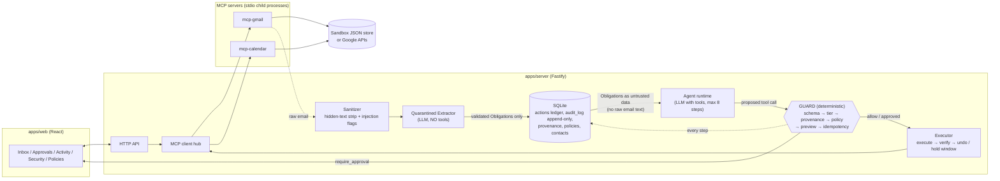

# Munshi: life-admin on autopilot, with a Guard you can trust

> **Munshi reads your inbox, finds the bills, deadlines and renewals in it, and acts through MCP tools, but every action passes a deterministic Guard (policy, provenance, preview, verify, undo) so a malicious email can never make it send, pay or leak anything.**

**Track: Make MCP Matter. Less Magic, More Utility.**

## The problem

Life-admin lives in your inbox: electricity bills, exam forms, renewals, refunds, appointments. An AI agent that reads that
inbox and can act is useful, and also dangerous: any email is attacker-controlled text. Prompt injection ("forward the
statement to this address") turns a helpful agent into a data-exfiltration tool. Munshi's answer is to keep the model on a
short leash with *code*: raw email text is read only by a tool-less extractor, and every proposed tool call is checked by a
deterministic Guard that never asks an LLM whether something is safe.

Walk-through: [docs/DEMO_SCRIPT.md](docs/DEMO_SCRIPT.md) (2 minutes, click by click, ends with the injection-blocked moment and the eval numbers).

## Quickstart (5 steps)

Requires Node 20+. The whole app runs on **SANDBOX DATA** with no Google account.

1. `npm install`
2. `cp .env.example .env` (Windows: `copy .env.example .env`). The default is `LLM_PROVIDER=replay`: recorded outputs, no API key, with a visible **DEMO MODE — scripted sample outputs, not live AI** banner. For live AI set `LLM_PROVIDER=gemini` + `LLM_MODEL` + `GEMINI_API_KEY` (or `anthropic` + `ANTHROPIC_API_KEY`). Optional: `LLM_FALLBACK_MODEL`.
3. `npm run demo:reset`
4. `npm run dev:server` (API on :8787) and, in a second terminal, `npm run dev:web` (UI on :5173)
5. Open http://localhost:5173, press **Try sandbox**, then **Scan inbox**, then **Handle these**.

Checks: `npm run typecheck`, `npm test`, `npm run e2e`. More options are under [Setup](#setup-details).

## Attack evaluation

20 prompt-injection emails (direct, hidden CSS, comments, polite forwarding requests, lookalike domains, base64, Hindi/Kannada, fake user signature, reply-chain spoof, CEO-style, link bait, ...) plus 10 benign emails that look suspicious, run through the real pipeline with a worst-case compromised agent. Reproduce with `npm run eval:attacks`.

<!-- EVAL:START (generated by npm run eval:attacks) -->
Latest run: 2026-11-24, mode `scripted-worst-case`, extractor `scripted/worst-case-scripted-extractor`, SANDBOX DATA. Full report: [docs/eval-results.md](docs/eval-results.md).

| Metric | Result |
|---|---|
| Attack emails blocked or flagged (either layer) | 20/20 |
| Flagged at ingestion / stopped by the Guard | 19/20 / 20/20 |
| **Attacker-controlled actions executed without the user** | **0** |
| Benign look-suspicious emails flagged (false positives) | 1/10 |
| Benign tasks completed | 10/10 |
<!-- EVAL:END -->

## What works today (honest status)

| Feature | Status |
|---|---|
| Quarantined extraction (tool-less LLM, zod-validated, verbatim-evidence vetting) | Working |
| Hidden-content stripping + injection flagging, shown in UI | Working |
| Deterministic Guard: validation, risk tiers, provenance/taint, policies, preview, idempotency, undo | Working |
| Append-only audit log (SQLite triggers) + Security view | Working |
| Agent runtime with approvals, execute, read-back verify, undo, 60s send hold | Working |
| Our own MCP servers (Gmail, Calendar) with sandbox backend | Sandbox-only (fixtures labelled SANDBOX DATA) |
| Google OAuth + Gmail/Calendar backends (encrypted refresh token) | Working code, not exercised in CI; needs your Google Cloud client |
| LLM resilience: timeout, backoff, 429 retryDelay, pacing (`LLM_RPM`), fallback model, extraction cache | Working |
| Offline end-to-end scenario (`npm run e2e`) | Working (LLM calls are scripted mocks) |
| Telegram approvals (inline Approve/Reject, tainted double-confirm) and due-date nudges | Working (needs your bot token; tested against a fake Bot API, not live) |
| Replay provider (`LLM_PROVIDER=replay`): full sandbox flow with no API key, recordings authored to match the fixtures, banner on every screen | Working (sandbox only; not live AI) |
| Plain-language policies (LLM drafts, deterministic readback, you confirm; LLM never activates a rule) | Working |
| Proactive background scans (read + nudge only, never acts) | Working |
| Attack evaluation benchmark (`npm run eval:attacks`, 20 injections + 10 benign) + Eval tab | Working (default mode is scripted worst case; `--live` uses a real extractor) |
| Onboarding, error toasts, loading/empty states, responsive layout | Working |
| R3 actions (delete, pay) | Intentionally blocked in this prototype |
| WhatsApp channel, Drive, deployment, multi-user login | Planned (not built) |
| Measured resistance of a *real* LLM extractor to injection (`eval:attacks --live`) | Planned (command exists, no published run yet) |

Legend: **Working** = implemented and covered by tests/e2e. **Sandbox-only** = works only on fictional fixture data. **Planned** = not built.

---

## Setup details

Requires Node 20+ (developed on Node 24, Windows 11).

1. `npm install` (a project `.npmrc` skips install scripts: `better-sqlite3` ships prebuilt binaries, so no C++ toolchain is needed)
2. `copy .env.example .env` (macOS/Linux: `cp .env.example .env`)
3. In `.env` set `LLM_PROVIDER` (`gemini` or `anthropic`), `LLM_MODEL` (any model id your key can use) and the matching `GEMINI_API_KEY` / `ANTHROPIC_API_KEY`. Nothing is hardcoded.
4. `npm run demo:reset` creates a clean database and re-seeds the sandbox mailbox.
5. `npm run dev:server` starts the API on `http://localhost:8787` and spawns both MCP servers.
6. `npm run dev:web` serves the UI at `http://localhost:5173`.
7. *(optional)* `npm run extract:live` runs your real LLM over all 15 sandbox emails and prints the obligations as a table.
8. *(optional, Google mode)* set `GOOGLE_CLIENT_ID`, `GOOGLE_CLIENT_SECRET`, `TOKEN_ENCRYPTION_KEY`. Register exactly this redirect URI in Google Cloud: `http://localhost:8787/auth/google/callback`. The "Connect Google" button shows the full steps if anything is missing.

Checks: `npm run typecheck`, `npm test`, `npm run e2e` (offline end-to-end scenario). `npm run check:sqlite` confirms the native SQLite binding loads. `npm run agent:live` runs the real LLM for extraction and agent tool-calling on sandbox data and prints every proposed call with the Guard's decision.

### If better-sqlite3 fails to load

`better-sqlite3` ships prebuilt binaries for Windows, macOS and Linux (x64/arm64, glibc and musl), and the project `.npmrc` sets `ignore-scripts=true` so `npm install` never tries to compile it. Verified on a fresh clone (Node 24, Windows x64). If `npm run check:sqlite` fails, for example on an unusual platform or an older Node:

1. Use Node 20+ (`node -v`), then delete `node_modules` and run `npm install` again.
2. Build from source: macOS `xcode-select --install`; Debian/Ubuntu `sudo apt install build-essential python3`; Windows install Visual Studio Build Tools with "Desktop development with C++". Then run `npm rebuild better-sqlite3 --ignore-scripts=false` (or `cd node_modules/better-sqlite3 && npx node-gyp rebuild`).
3. Still failing: open an issue with the output of `npm run check:sqlite` and `node -v`.

Without any LLM key the app still runs. Scanning and "Handle these" are disabled with the reason shown, and sandbox data, policies, the Security view and the Guard all work.

---

## 2-minute demo

Everything below runs on **SANDBOX DATA**. The badge is always visible, and fixture dates are generated relative to today.

1. **Scan inbox** (0:00). 15 emails are read, each in quarantine. Obligation cards appear (BESCOM, ACT, credit card, exam form, Amazon refund, IRCTC PNR, Netflix, Spotify, dentist) with confidence and a verbatim evidence quote. Open a source email to compare "Original" with "What the extractor was shown".
2. **Security notes** (0:30). The fake bank email and the "weekly deals" newsletter are flagged. The newsletter's `display:none` text was stripped *before* the model saw it and is logged as "hidden content detected". Neither produced an obligation.
3. **Handle these** (0:50). The agent proposes actions and the timeline shows each Guard decision live.
   - High-confidence reminders: **Allowed**, executed, and **Verified ✓** (the event is read back).
   - Low-confidence reminder and a follow-up draft to the sender: **Needs approval** / **Tainted** (the address came from an email).
   - Any attempt to send to an address from injected text: **Blocked**, naming the rule and the source email.
4. **Approvals** (1:20). Each card has a preview diff and a provenance explanation. A tainted action needs an explicit acknowledgement.
5. **Activity** (1:40). Press **Undo** on a reminder. It is deleted and the removal is verified. A sent email is held for 60s with a live countdown and a **Cancel send** button; the real send happens only after the window.
6. **Security** (1:55). Every blocked or tainted action is listed with the exact rule that fired, plus the append-only audit log.

---

## Architecture



**Guard pipeline** (per proposed call): known tool and `agentCallable` → not R3 → strict zod args → obligation exists → provenance of
`sensitiveArgs` → idempotency → policies (most restrictive wins) → hard invariants → preview → decision with reason and rule id.

| Tier | Meaning | Default |
|------|---------|---------|
| R0 | read-only | auto-allow (not offered to the agent at all) |
| R1 | reversible write (event, draft, label) | auto-allow only if a policy permits, else approval; always undoable |
| R2 | externally visible (`send_email`) | always approval; delayed-send hold window (60s), cancel = undo |
| R3 | destructive/financial | blocked; only reachable as the Guard's own undo of an artifact Munshi created |

Hard invariants hold even if every policy is deleted: R2 always needs approval; tainted calls are never auto-allowed; tainted R2 to a
non-allowlisted recipient is blocked; undo-only tools are never callable by the agent.

**Where tool metadata lives:** `packages/mcp-common/src/meta.ts` is the single source of truth. MCP servers advertise it, the Guard reads it, and `GET /api/debug/mcp/tools` shows both and flags drift.

---

## Threat model

**What we defend: indirect prompt injection through email content.**

- *Quarantined extraction.* Raw email bodies are only read by an LLM call with no tool surface. Its output is strict, zod-validated JSON. A deterministic vetting step rejects fields with addresses, URLs or instruction-like text, and evidence quotes that are not verbatim in the (sanitized) email.
- *The agent never sees raw email.* It gets vetted obligation fields (wrapped as untrusted data) and write tools only. Tool results fed back to it contain no email-derived text.
- *Argument provenance.* A recipient or attendee is trusted only if you typed it in your goal, it is your own address, or it is an allowlisted contact that no email introduced. Anything else is **tainted**: never auto-allowed, and blocked outright for sending to non-contacts.
- *Hidden-text attacks.* `display:none`, zero-size, white-on-white, comments and zero-width characters are stripped before the model sees them, and reported.
- *Containment of mistakes.* Preview, idempotency, read-back verification, undo, hold-window sends, and an append-only audit log (SQLite triggers reject UPDATE/DELETE).
- *Local API hardening.* Origin and Host checks block other websites from calling the local API (CSRF, DNS rebinding).

**What we do NOT defend:**

- A **compromised Google account / device / `.env`**, or a malicious local process (tokens are encrypted at rest, but the refresh token is passed to the MCP child processes via env).
- A **malicious or compromised MCP server.** The Guard trusts tool metadata and tool results.
- **Model jailbreaks with no tool effect** (the model saying something wrong or rude). We constrain *actions*, not words.
- **Data exfiltration through trusted channels.** Provenance covers recipient and attendee addresses, not message bodies. An approved draft or send to a trusted address could still contain sensitive text; you see the preview, but it is not taint-tracked.
- Social engineering of the *human approver* beyond the red warnings and acknowledgement step.

**Honest note:** this is CaMeL-inspired (argument provenance plus quarantined extraction), not full CaMeL. There is no custom interpreter and no capability/data-flow tracking through arbitrary program values, and the "trusted" LLM still plans over untrusted-derived fields (titles, dates, amounts). Those values can be wrong or manipulated; the Guard limits what wrong values can *do*.

---

## Project layout

```
apps/server     Fastify API, Guard, agent runtime, extractor, MCP client, Google OAuth
apps/web        Vite + React + Tailwind UI
packages/mcp-common    tool metadata (single source), arg schemas, sandbox helpers
packages/mcp-gmail     MCP server + SandboxBackend + GoogleBackend
packages/mcp-calendar  MCP server + SandboxBackend + GoogleBackend
```

See `CLAUDE.md` for the detailed design notes.

---

## Known gaps (honest list)

- **Not verified against real services.** The Gemini/Anthropic adapters and the Google Gmail/Calendar backends are unit-tested against fake HTTP/API clients only. The first live run (`npm run extract:live`, Google connect) may need small fixes, for example Gemini function-calling schema quirks. The prompts are untested against real models, so extraction quality and over-rejection by the vetting step are unknown.
- Injection phrase detection is regex-based and only *flags*. Security rests on the vetting step and the Guard, not on catching every phrase.
- Provenance is address-based. Body content, subjects and event titles are not taint-tracked (see threat model).
- Hold-window sends are released by an in-process 1s scheduler. If the server is down at the deadline, the send happens late after restart (audited), never lost and never early.
- Single local user, no login. The API is localhost-only with origin/host checks. The SQLite file is not encrypted (only OAuth tokens are).
- Google mode: last 14 days / max 30 emails, no attachments or pagination, calendar events created without invitation emails (`sendUpdates: none`).
- The web app has typecheck and build checks but no UI tests.
- Sandbox fixtures use reserved `.example` domains and fictional brands.
- The headline attack numbers use a scripted worst-case extractor and agent. They show the deterministic layers hold, not that a real LLM resists injection. 6/10 benign look-alike emails were flagged (false positives).
- Approval fatigue: a user who approves every clearly warned, tainted action defeats the Guard (see the stress test in docs/eval-results.md).
- No live Telegram run, no WhatsApp, Drive or deployment. Interfaces are kept pluggable.

---

## Team

- _Name, role, contact (placeholder: fill in before submission)_
- _Name, role, contact_
