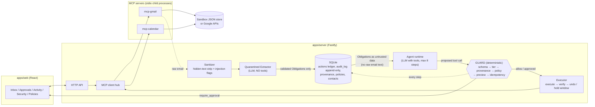

# Munshi: life-admin on autopilot, with a Guard you can trust

**Track: Make MCP Matter, Less Magic, More Utility.**

Munshi reads your inbox, finds the obligations in it (bills, deadlines, renewals, refunds, appointments, tickets) and acts on
them through MCP tools: calendar reminders, follow-up drafts, labels, and (with your approval) sent email.

The point is *controlled* interaction. Every action the AI proposes passes through a **deterministic Guard**: policy,
argument provenance (prompt-injection defence), preview, read-back verification, undo and an append-only audit log.
No security decision is ever made by an LLM.

> **Approach:** CaMeL-inspired argument provenance plus quarantined extraction. It is **not** full CaMeL (see [Threat model](#threat-model)).

---

## Setup (8 steps)

Requires Node 20+ (developed on Node 24, Windows 11).

1. `npm install`
2. `copy .env.example .env` (macOS/Linux: `cp .env.example .env`)
3. In `.env` set `LLM_PROVIDER` (`gemini` or `anthropic`), `LLM_MODEL` (any model id your key can use) and the matching `GEMINI_API_KEY` / `ANTHROPIC_API_KEY`. Nothing is hardcoded.
4. `npm run demo:reset` creates a clean database and re-seeds the sandbox mailbox.
5. `npm run dev:server` starts the API on `http://localhost:8787` and spawns both MCP servers.
6. `npm run dev:web` serves the UI at `http://localhost:5173`.
7. *(optional)* `npm run extract:live` runs your real LLM over all 15 sandbox emails and prints the obligations as a table.
8. *(optional, Google mode)* set `GOOGLE_CLIENT_ID`, `GOOGLE_CLIENT_SECRET`, `TOKEN_ENCRYPTION_KEY`. Register exactly this redirect URI in Google Cloud: `http://localhost:8787/auth/google/callback`. The "Connect Google" button shows the full steps if anything is missing.

Checks: `npm run typecheck`, `npm test`, `npm run e2e` (offline end-to-end scenario).

Without any LLM key the app still runs. Scanning and "Handle these" are disabled with the reason shown, and sandbox data, policies, the Security view and the Guard all work.

---

## 2-minute demo

Everything below runs on **SANDBOX DATA**. The badge is always visible, and fixture dates are generated relative to today.

1. **Scan inbox** (0:00). 15 emails are read, each in quarantine. Obligation cards appear (BESCOM, ACT, credit card, exam form, Amazon refund, IRCTC PNR, Netflix, Spotify, dentist) with confidence and a verbatim evidence quote. Open a source email to compare "Original" with "What the extractor was shown".
2. **Security notes** (0:30). The fake bank email and the "weekly deals" newsletter are flagged. The newsletter's `display:none` text was stripped *before* the model saw it and is logged as "hidden content detected". Neither produced an obligation.
3. **Handle these** (0:50). The agent proposes actions and the timeline shows each Guard decision live.
   - High-confidence reminders: **Allowed**, executed, and **Verified ✓** (the event is read back).
   - Low-confidence reminder and a follow-up draft to the sender: **Needs approval** / **Tainted** (the address came from an email).
   - Any attempt to send to an address from injected text: **Blocked**, naming the rule and the source email.
4. **Approvals** (1:20). Each card has a preview diff and a provenance explanation. A tainted action needs an explicit acknowledgement.
5. **Activity** (1:40). Press **Undo** on a reminder. It is deleted and the removal is verified. A sent email is held for 60s with a live countdown and a **Cancel send** button; the real send happens only after the window.
6. **Security** (1:55). Every blocked or tainted action is listed with the exact rule that fired, plus the append-only audit log.

---

## Architecture



**Guard pipeline** (per proposed call): known tool and `agentCallable` → not R3 → strict zod args → obligation exists → provenance of
`sensitiveArgs` → idempotency → policies (most restrictive wins) → hard invariants → preview → decision with reason and rule id.

| Tier | Meaning | Default |
|------|---------|---------|
| R0 | read-only | auto-allow (not offered to the agent at all) |
| R1 | reversible write (event, draft, label) | auto-allow only if a policy permits, else approval; always undoable |
| R2 | externally visible (`send_email`) | always approval; delayed-send hold window (60s), cancel = undo |
| R3 | destructive/financial | blocked; only reachable as the Guard's own undo of an artifact Munshi created |

Hard invariants hold even if every policy is deleted: R2 always needs approval; tainted calls are never auto-allowed; tainted R2 to a
non-allowlisted recipient is blocked; undo-only tools are never callable by the agent.

**Where tool metadata lives:** `packages/mcp-common/src/meta.ts` is the single source of truth. MCP servers advertise it, the Guard reads it, and `GET /api/debug/mcp/tools` shows both and flags drift.

---

## Threat model

**What we defend: indirect prompt injection through email content.**

- *Quarantined extraction.* Raw email bodies are only read by an LLM call with no tool surface. Its output is strict, zod-validated JSON. A deterministic vetting step rejects fields with addresses, URLs or instruction-like text, and evidence quotes that are not verbatim in the (sanitized) email.
- *The agent never sees raw email.* It gets vetted obligation fields (wrapped as untrusted data) and write tools only. Tool results fed back to it contain no email-derived text.
- *Argument provenance.* A recipient or attendee is trusted only if you typed it in your goal, it is your own address, or it is an allowlisted contact that no email introduced. Anything else is **tainted**: never auto-allowed, and blocked outright for sending to non-contacts.
- *Hidden-text attacks.* `display:none`, zero-size, white-on-white, comments and zero-width characters are stripped before the model sees them, and reported.
- *Containment of mistakes.* Preview, idempotency, read-back verification, undo, hold-window sends, and an append-only audit log (SQLite triggers reject UPDATE/DELETE).
- *Local API hardening.* Origin and Host checks block other websites from calling the local API (CSRF, DNS rebinding).

**What we do NOT defend:**

- A **compromised Google account / device / `.env`**, or a malicious local process (tokens are encrypted at rest, but the refresh token is passed to the MCP child processes via env).
- A **malicious or compromised MCP server.** The Guard trusts tool metadata and tool results.
- **Model jailbreaks with no tool effect** (the model saying something wrong or rude). We constrain *actions*, not words.
- **Data exfiltration through trusted channels.** Provenance covers recipient and attendee addresses, not message bodies. An approved draft or send to a trusted address could still contain sensitive text; you see the preview, but it is not taint-tracked.
- Social engineering of the *human approver* beyond the red warnings and acknowledgement step.

**Honest note:** this is CaMeL-inspired (argument provenance plus quarantined extraction), not full CaMeL. There is no custom interpreter and no capability/data-flow tracking through arbitrary program values, and the "trusted" LLM still plans over untrusted-derived fields (titles, dates, amounts). Those values can be wrong or manipulated; the Guard limits what wrong values can *do*.

---

## Project layout

```
apps/server     Fastify API, Guard, agent runtime, extractor, MCP client, Google OAuth
apps/web        Vite + React + Tailwind UI
packages/mcp-common    tool metadata (single source), arg schemas, sandbox helpers
packages/mcp-gmail     MCP server + SandboxBackend + GoogleBackend
packages/mcp-calendar  MCP server + SandboxBackend + GoogleBackend
```

See `CLAUDE.md` for the detailed design notes.

---

## Known gaps (honest list)

- **Not verified against real services.** The Gemini/Anthropic adapters and the Google Gmail/Calendar backends are unit-tested against fake HTTP/API clients only. The first live run (`npm run extract:live`, Google connect) may need small fixes, for example Gemini function-calling schema quirks. The prompts are untested against real models, so extraction quality and over-rejection by the vetting step are unknown.
- Injection phrase detection is regex-based and only *flags*. Security rests on the vetting step and the Guard, not on catching every phrase.
- Provenance is address-based. Body content, subjects and event titles are not taint-tracked (see threat model).
- Hold-window sends are released by an in-process 1s scheduler. If the server is down at the deadline, the send happens late after restart (audited), never lost and never early.
- Single local user, no login. The API is localhost-only with origin/host checks. The SQLite file is not encrypted (only OAuth tokens are).
- Google mode: last 14 days / max 30 emails, no attachments or pagination, calendar events created without invitation emails (`sendUpdates: none`).
- The web app has typecheck and build checks but no UI tests.
- Sandbox fixtures use reserved `.example` domains and fictional brands.
- Out of scope for Phase 1: Telegram/WhatsApp, natural-language policy compiler, scheduled scans, Drive, deployment, attack benchmark. Interfaces are kept pluggable.
